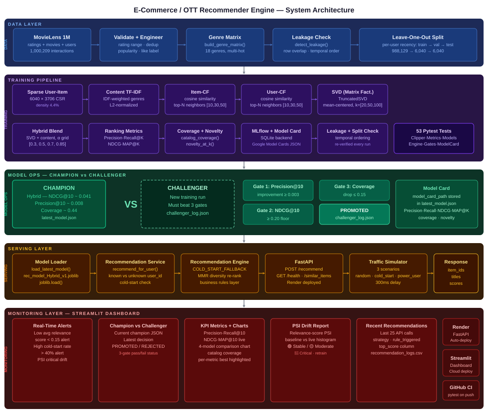
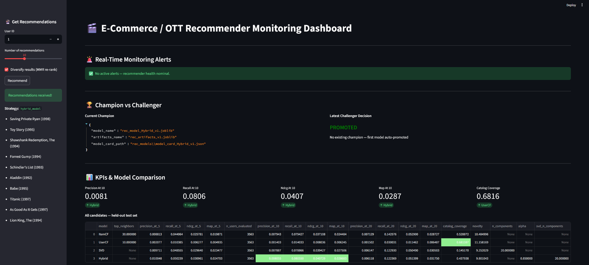
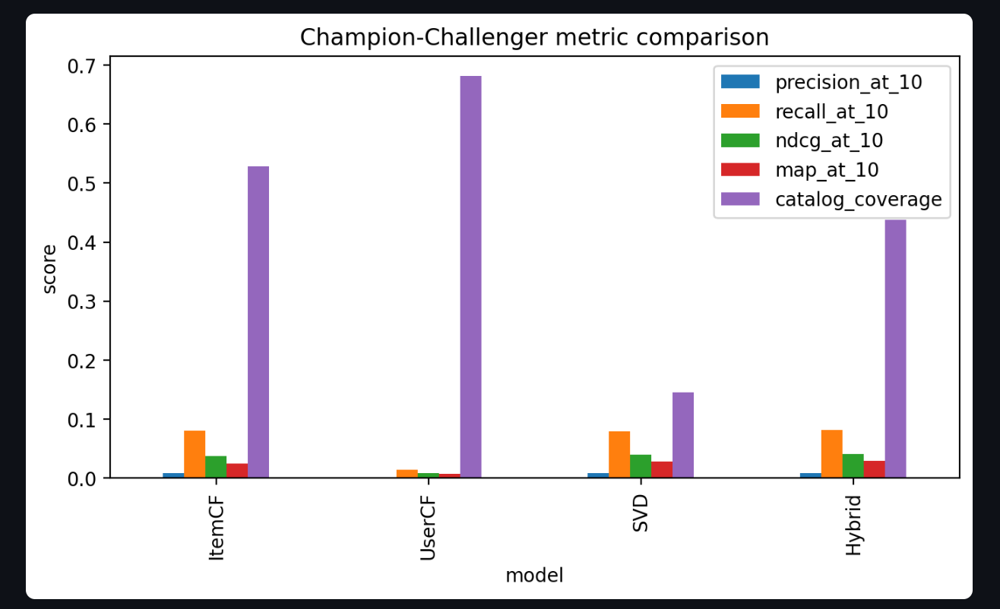
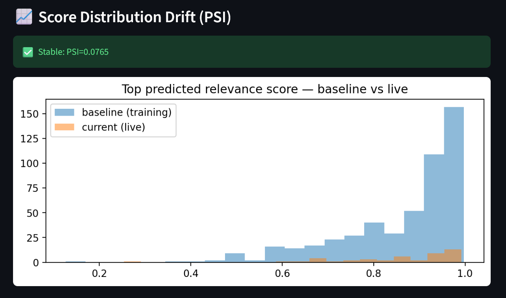
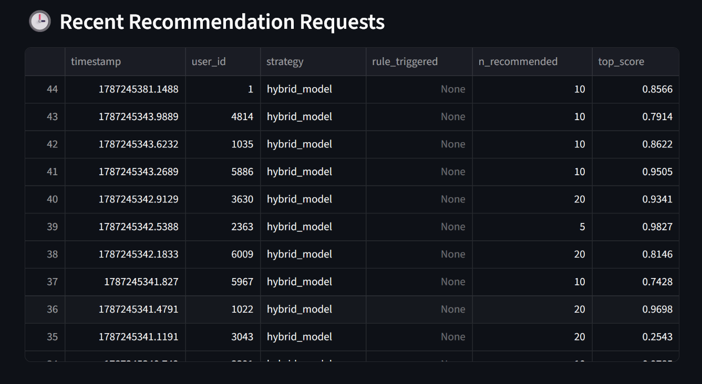
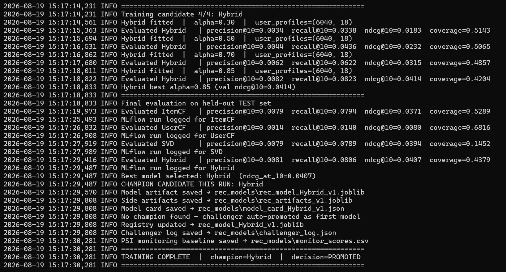
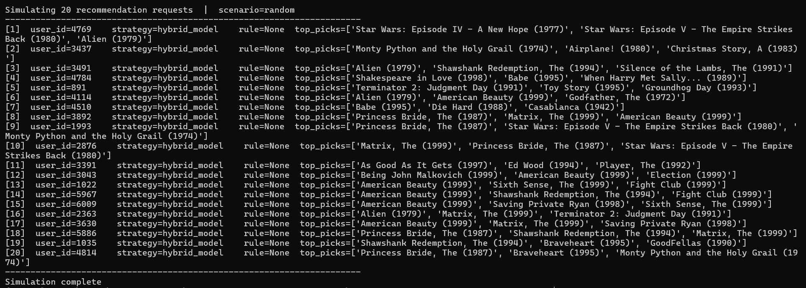
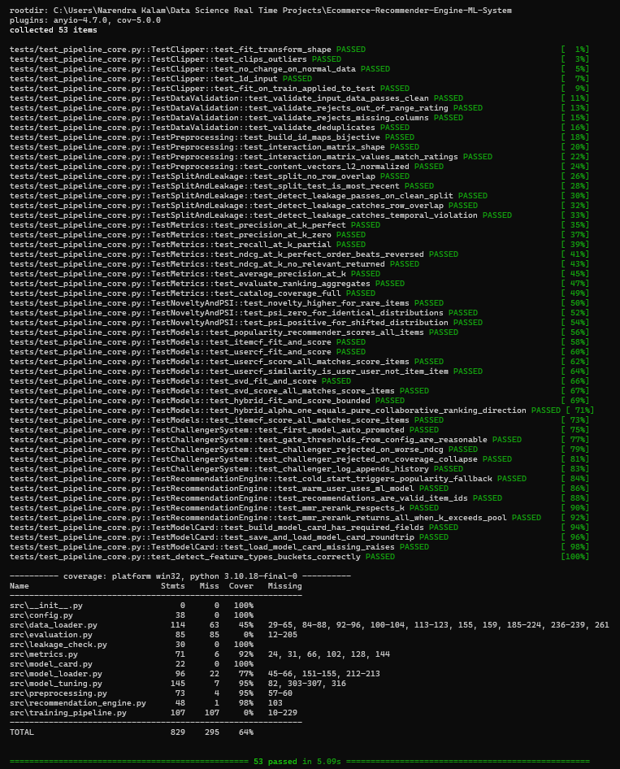
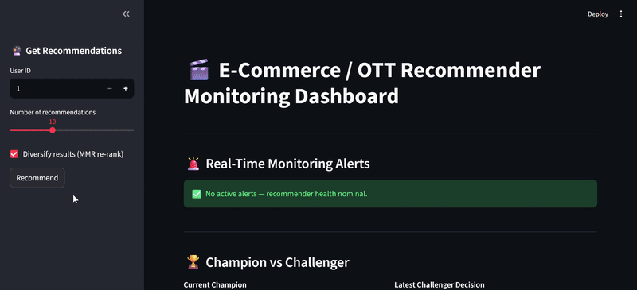

# 🎬 E-Commerce / OTT Recommender Engine — Hybrid Recommendation System

[](https://github.com/narendrakalam2001/ecommerce-recommender-engine-mlops/actions)
[](https://python.org)
[](https://scikit-learn.org)
[](https://fastapi.tiangolo.com)
[](https://streamlit.io)
[](#-champion-vs-challenger--3-gate-promotion)
[](https://docker.com)
[](https://mlflow.org)
[](LICENSE)

> **Domain:** E-Commerce / OTT Streaming — Personalization & Recommendation Systems
> **Problem:** Hybrid Recommendation — collaborative filtering + content-based ranking across a 3,706-item catalog
> **Dataset:** [MovieLens 1M — GroupLens — 1,000,209 ratings · 6,040 users · 3,883 movies](https://grouplens.org/datasets/movielens/1m/)
> **Industry Context:** Netflix India · Amazon · Myntra · Meesho — recommendation engines directly drive **30–40% of total revenue** through personalized suggestions

---

## 💡 Why This Project Matters

Most portfolio recommenders stop at "here's a cosine-similarity function." Production recommenders are a **business decision system**: cold-start users need a different policy than warm users, a model that maximizes precision by only ever recommending the same 20 blockbusters is actively bad for the business (kills catalog discovery and long-tail revenue), and every model promotion needs a governance gate — not a vibe check. This system implements that full loop:

- **4 Champion-Challenger candidates** (Item-CF, User-CF, SVD, Hybrid) compete on identical held-out data — not just one model trained and shipped
- **User-CF was deliberately included to fail** — it demonstrates, with real numbers, *why* production systems favor item-based/model-based CF instead of just asserting it
- The **Hybrid model** blends SVD's collaborative signal with genre TF-IDF content similarity — recovering 3x the catalog coverage of pure SVD while keeping its higher ranking quality
- A **leave-one-out temporal split** (per-user recency, not a random split) + programmatic leakage detection guarantees no future interaction ever leaks into training
- Every model promotion goes through a **3-gate Champion-Challenger** check — no model reaches production without demonstrably better precision, a quality floor, and a catalog-coverage guard against collapse
- **MMR diversity re-ranking** at serving time actively counters popularity bias instead of just measuring it

This mirrors how Netflix India / Amazon / Myntra / Meesho actually engineer recommendation infrastructure — the same interaction-log schema (`user_id, item_id, rating, timestamp, item side-features`) ports directly from this OTT framing to e-commerce product recommendations.

---

## 🏆 Champion Model Results

| Metric | Score |
|---|---|
| **Champion Model** | `Hybrid (SVD + Content TF-IDF, α=0.85)` |
| **NDCG@10** | `0.0407` |
| **Precision@10** | `0.0081` |
| **Recall@10** | `0.0806` |
| **MAP@10** | `0.0287` |
| **Catalog Coverage** | `0.4379` (3x higher than pure SVD) |
| **Novelty@10** | `9.80` |
| **Champion vs SVD alone** | `+3% NDCG@10, +200% catalog coverage` |
| **Champion vs Item-CF alone** | `+10% NDCG@10` |
| **Weakest candidate (User-CF)** | `NDCG@10 = 0.0080` — ~5x worse, included on purpose |
| **Total training time (4 models, full grid search)** | `~70–120 seconds` on 1M ratings |
| **Test suite** | `53/53 pytest passing` |

> Full-catalog leave-one-out evaluation — for every user, the model ranks the **entire 3,706-item catalog** (minus items already seen) and is scored on whether the single held-out "next" interaction lands in the top-K. This is a substantially harder, more realistic protocol than the common 1-positive-vs-99-sampled-negatives setup — absolute scores are lower, but they reflect production reality. See [Limitations & Considerations](#-limitations--considerations).

---

## 🔗 Live Links

| Service | URL |
|---|---|
| 🚀 **FastAPI (Swagger UI)** | [https://ecommerce-recommender-engine-mlops.onrender.com/docs](https://ecommerce-recommender-engine-mlops.onrender.com/docs) |
| 📊 **Monitoring Dashboard** | [https://ecommerce-recommender-engine-mlops.streamlit.app](https://ecommerce-recommender-engine-mlops.streamlit.app) |
| 📓 **EDA Notebook** | [notebooks/instacart_market_basket_eda.ipynb](notebooks/instacart_market_basket_eda.ipynb) |

> ⚠️ Render free tier: first request may take 30–60 seconds (cold start).

---

## 🏗️ System Architecture



```
╔══════════════════════════════════════════════════════════════════════════════════╗
║        E-COMMERCE / OTT RECOMMENDER ENGINE — 5-LAYER PRODUCTION SYSTEM           ║
╠══════════════════════════════════════════════════════════════════════════════════╣
║                                                                                  ║
║  ┌─────────────────────────────── DATA LAYER ──────────────────────────────┐     ║
║  │  MovieLens 1M → Validate + Engineer → Genre Matrix → Leakage Check      │     ║
║  │  1,000,209 ratings · leave-one-out split: 988,129 / 6,040 / 6,040       │     ║
║  └───────────────────────────────────┬─────────────────────────────────────┘     ║
║                                      ▼                                           ║
║  ┌─────────────────────────── TRAINING PIPELINE ───────────────────────────┐     ║
║  │                                                                         │     ║
║  │  ┌──────────────────┐    ┌───────────────┐    ┌──────────────────────┐  │     ║
║  │  │  Sparse Matrix   │    │  4 Candidates │    │  Evaluation          │  │     ║
║  │  │  6040 × 3706 CSR │───▶│  ItemCF·UserCF│───▶│  Precision/Recall@K │  │     ║
║  │  │  Genre TF-IDF    │    │  SVD · Hybrid │    │  NDCG·MAP·Coverage   │  │     ║
║  │  └──────────────────┘    └───────────────┘    └──────────────────────┘  │     ║
║  │                                                                         │     ║
║  │  Per-user mean-centered SVD · Bayesian-smoothed popularity fallback     │     ║
║  │  MLflow (SQLite backend) · Google Model Cards JSON                      │     ║
║  │                                                                         │     ║
║  │  CHAMPION → Hybrid  NDCG@10=0.0407  Coverage=0.4379  (α=0.85)           │     ║
║  └───────────────────────────────────┬─────────────────────────────────────┘     ║
║                                      ▼                                           ║
║  ┌──────────────────────── CHAMPION-CHALLENGER ────────────────────────────┐     ║
║  │                                                                         │     ║
║  │  Gate 1: Precision@10 improvement ≥ 0.003  →  ✅ PASS / ❌ FAIL        │     ║
║  │  Gate 2: NDCG@10                  ≥ 0.20   →  ✅ PASS / ❌ FAIL        │     ║
║  │  Gate 3: catalog-coverage drop    ≤ 0.15   →  ✅ PASS / ❌ FAIL        │     ║
║  │                                                                         │     ║
║  │  ALL gates pass → PROMOTED (latest_model.json updated)                  │     ║
║  │  ANY gate fails → REJECTED (champion retained, result logged)           │     ║
║  └───────────────────────────────────┬─────────────────────────────────────┘     ║
║                                      ▼                                           ║
║  ┌──────────────────────────── SERVING LAYER ──────────────────────────────┐     ║
║  │                                                                         │     ║
║  │  Model Loader → Recommendation Service → Recommendation Engine → FastAPI│     ║
║  │                                                                         │     ║
║  │  POST /recommend      → user_id → top-K items (→ ranked + diversified)  │     ║
║  │  GET  /similar_items  → item_id → content-based "more like this"        │     ║
║  │  GET  /health         → API health check  (→ {status, model_loaded})    │     ║
║  │  GET  /model_info     → champion registry (→ model_name, card path)     │     ║
║  │                                                                         │     ║
║  │  Recommendation Engine business rules:                                  │     ║
║  │    → COLD_START_POPULARITY_FALLBACK (< 5 ratings)                       │     ║
║  │    → MMR diversity re-rank (λ=0.7) — no top-10 of near-duplicate items  │     ║
║  └───────────────────────────────────┬─────────────────────────────────────┘     ║
║                                      ▼                                           ║
║  ┌─────────────────── MONITORING LAYER — STREAMLIT DASHBOARD ──────────────┐     ║
║  │                                                                         │     ║
║  │  Section 1: Real-Time Alerts    → low relevance · high cold-start rate  │     ║
║  │  Section 2: Champion-Challenger → decision · 3-gate status · history    │     ║
║  │  Section 3: KPIs + Charts       → Precision/Recall/NDCG/MAP@10 · 4-model│     ║
║  │  Section 4: PSI Drift           → relevance-score PSI=0.0765 (STABLE)   │     ║
║  │  Section 5: Recent Recs         → audit log · strategy · rule_triggered │     ║
║  │  Sidebar:   Live Recommend      → enter user_id → instant top-K list    │     ║
║  │                                                                         │     ║
║  │  Simulator: 3 scenarios (random · cold_start · power_user) → /recommend │     ║
║  └─────────────────────────────────────────────────────────────────────────┘     ║
╚══════════════════════════════════════════════════════════════════════════════════╝
```

---

## 📸 Dashboard Screenshots

### 🖥️ Full Dashboard UI

Real-time recommendation dashboard — Live sidebar recommend widget · Champion-Challenger system · KPI cards · PSI drift · recent-request audit log.



---

### 📊 Champion-Challenger Metric Comparison

All 4 candidates on the held-out test set — Hybrid wins Precision/Recall/NDCG/MAP@10 while recovering most of Item-CF's catalog coverage; User-CF shows the highest coverage but by far the weakest ranking quality.



---

### 📈 Score Distribution Drift (PSI)

Predicted relevance-score distribution — baseline (training) vs live traffic — PSI=0.0765, well under the 0.10 "stable" threshold.



---

### 📋 Recent Recommendation Requests

Live audit log of `/recommend` calls — user_id, strategy (hybrid_model vs popularity fallback), rule triggered, and top predicted relevance score per request.



---

## 📊 Training Reports

| Training & Evaluation Summary | Simulation Run |
|---|---|
|  |  |

| Test Coverage |
|---|
|  |

---

## 🎬 System Demo



---

## 📁 Project Structure

```
Ecommerce-Recommender-Engine-ML-System/
│
├── src/                                    # Core ML system
│   ├── config.py                           # All constants — grids, gate thresholds, paths
│   ├── data_loader.py                      # MovieLens loader · auto-download · feature engineering
│   ├── preprocessing.py                    # Clipper · id maps · sparse matrix · leave-one-out split
│   ├── leakage_check.py                    # Row-overlap + temporal-ordering leakage guard
│   ├── metrics.py                          # Precision/Recall/NDCG/MAP@K · coverage · novelty · PSI
│   ├── model_tuning.py                     # ItemCF · UserCF · SVD · Hybrid · Popularity classes
│   ├── evaluation.py                       # Batch ranking eval · model selection · MLflow logging
│   ├── model_card.py                       # Google Model Cards-style JSON model card
│   ├── model_loader.py                     # Champion-Challenger 3-gate promotion system
│   ├── recommendation_engine.py           # Business rules + MMR diversity re-ranking
│   └── training_pipeline.py               # End-to-end training pipeline
│
├── serving/
│   └── recommender_api.py                  # FastAPI: /recommend · /similar_items · /health · /model_info
│
├── services/
│   └── recommendation_service.py          # Known vs unknown user_id routing
│
├── monitoring/
│   └── monitoring_dashboard.py            # Streamlit: 5-section monitoring dashboard
│
├── simulation/
│   └── user_interaction_simulator.py      # 3-scenario traffic generator (random · cold_start · power_user)
│
├── tests/
│   └── test_pipeline_core.py              # 53 pytest unit tests — all passing
│
├── scripts/
│   ├── train_model.py                      # python scripts/train_model.py
│   ├── run_api.py                          # python scripts/run_api.py
│   ├── run_dashboard.py                    # python scripts/run_dashboard.py
│   └── run_simulation.py                  # python scripts/run_simulation.py
│
├── notebooks/
│   ├── instacart_market_basket_eda.ipynb     # Professional EDA — 20 steps, fully executed on real data
│   └──instacart_market_basket_eda.html              
│
├── data/
│   ├── sample_aisles.csv                       # Small sample of MovieLens for quick smoke-testing
│   │      (ratings/movies/users subset)    # <- adjust this path if your sample folder is named differently
│   ├── sample_departments.csv
│   ├── sample_order_products_prior.csv
│   ├── sample_order_products_train.csv
│   ├── sample_orders.csv
│   └── sample_products.csv                              
│
├── rec_models/                             # Model artifacts — JSON files pushed to GitHub
│   ├── latest_model.json                   # Champion model registry
│   ├── challenger_log.json                 # Full Champion-Challenger comparison history
│   ├── model_card_Hybrid_v1.json           # Google Model Card JSON
│   ├── model_experiment_results.csv        # All 4 candidates' test-set metrics
│   └── monitor_scores.csv                  # PSI monitoring baseline
│
├── docs/
│   ├── architecture/
│   │   └── system_architecture.svg         # 5-layer system architecture diagram
│   ├── screenshots/
│   │   ├── dashboard_full_ui.png           # Full Streamlit dashboard UI
│   │   ├── champion_challenger_metric.png  # 4-model comparison bar chart
│   │   ├── score_distribution_drift(psi).png  # PSI drift chart
│   │   └── recent_recommendation_requests.png # Recent requests audit log
│   ├── reports/
│   │   ├── training_model_summary.png      # Training pipeline log summary
│   │   ├── simulation.png                  # Simulation run terminal output
│   │   └── test_coverage.png               # pytest 53/53 coverage report
│   └── gifs/
│       └── system_demo.gif                 # End-to-end system demo
│
├── logs/
│   └── recommendation_logs.csv             # API request audit log (auto-generated)
│
├── Dockerfile                              # FastAPI production image
├── Dockerfile.dashboard                    # Streamlit dashboard container
├── docker-compose.yml                      # API + Dashboard (ports 8000 + 8501)
├── .github/workflows/ci.yml               # GitHub Actions — pytest on every push
├── .gitignore
├── LICENSE                                 # MIT License
├── README.md                               # This file
├── render.yaml                             # Render.com deployment config
├── requirements.txt                        # All dependencies
├── requirements_api.txt                    # Lean API-only image dependencies
└── requirements_dashboard.txt              # Lean dashboard-only image dependencies
```

---

## 🚀 Quickstart

### 1. Clone & Install

```bash
git clone https://github.com/narendrakalam2001/ecommerce-recommender-engine-mlops.git
cd ecommerce-recommender-engine-mlops
pip install -r requirements.txt
```

### 2. Dataset

The full [MovieLens 1M](https://grouplens.org/datasets/movielens/1m/) dataset **auto-downloads** into `data/ml-1m/` the first time you run `train_model.py` — no manual step required. A small sample is also included in `data/ml-1m-sample/` for quick smoke-testing without the full download.

A **representative sample dataset is already included** at `data/` for
quick testing without downloading anything.


### 3. Train Model

```bash
python scripts/train_model.py
```

Expected output:
```
INFO  Data validation passed  | shape=(1000209, 4)  users=6040  items=3706
INFO  Leave-one-out split     | train=988129  val=6040  test=6040
INFO  Leakage check passed    | no row overlap, no temporal violations
INFO  Training candidate 1/4: ItemCF  → best top_neighbors=30 (val ndcg@10=0.0412)
INFO  Training candidate 2/4: UserCF  → best top_neighbors=10 (val ndcg@10=0.0094)
INFO  Training candidate 3/4: SVD     → best n_components=20 (val ndcg@10=0.0432)
INFO  Training candidate 4/4: Hybrid  → best alpha=0.85 (val ndcg@10=0.0414)
INFO  Best model selected: Hybrid  (ndcg_at_10=0.0407)
INFO  CHAMPION CANDIDATE THIS RUN: Hybrid
INFO  TRAINING COMPLETE  |  champion=Hybrid  |  decision=PROMOTED
```

### 4. Start API

```bash
python scripts/run_api.py
# API:  http://localhost:8000
# Docs: http://localhost:8000/docs
```

### 5. Start Dashboard

```bash
python scripts/run_dashboard.py
# Dashboard: http://localhost:8501
```

### 6. Run Simulation

```bash
python scripts/run_simulation.py
# Simulates 20 recommendation requests across random / cold_start / power_user scenarios
```

### 7. Run Tests

```bash
pytest tests/test_pipeline_core.py -v --cov=src --cov-report=term-missing
# 53 collected · 53 passed · 0 failed
```

---

## 🐳 Docker

```bash
# Start everything
docker compose up --build

# API only
docker compose up api

# Dashboard only
docker compose up dashboard

# Stop
docker compose down
```

| Service | URL |
|---|---|
| FastAPI + Swagger | `http://localhost:8000/docs` |
| Streamlit Dashboard | `http://localhost:8501` |

---

## 🌐 API Reference

### POST /recommend — Top-K Recommendations for a User

```bash
curl -X POST "http://localhost:8000/recommend" \
  -H "Content-Type: application/json" \
  -d '{"user_id": 1, "k": 10, "diversify": true}'
```

**Response:**
```json
{
  "recommended_items": [2028, 1, 318, 356, 527, 588, 34, 1721, 1784, 364],
  "recommended_titles": ["Saving Private Ryan (1998)", "Toy Story (1995)", "..."],
  "rule_triggered": null,
  "strategy": "hybrid_model",
  "scores": [0.8566, 0.8391, 0.8471, 0.8462, 0.8497, 0.8356, 0.8195, 0.8149, 0.8167, 0.8237],
  "user_id": 1,
  "latency_seconds": 0.012
}
```

Unknown / brand-new `user_id` → automatically falls back to popularity-based recommendations (`rule_triggered: "NEW_USER_NOT_IN_CATALOG"`).

### GET /similar_items/{item_id} — Content-Based "More Like This"

```bash
curl "http://localhost:8000/similar_items/1?k=5"
```

Returns genre-similarity neighbors for a given item, independent of any user.

### GET /health

```json
{"status": "running", "model_loaded": true}
```

### GET /model_info

Returns the champion registry — model file name, artifacts file name, model card path.

---

## 📊 All 4 Candidate Models — Comparison Table

| Model | Precision@10 | Recall@10 | NDCG@10 | MAP@10 | Catalog Coverage | Novelty |
|---|---|---|---|---|---|---|
| User-CF | 0.0014 | 0.0140 | 0.0080 | 0.0062 | **0.6816** | 11.16 |
| Item-CF | 0.0079 | 0.0794 | 0.0371 | 0.0245 | 0.5289 | 10.48 |
| SVD (MF) | 0.0079 | 0.0789 | 0.0394 | 0.0275 | 0.1452 | 9.25 |
| **Hybrid** ⭐ | **0.0081** | **0.0806** | **0.0407** | **0.0287** | 0.4379 | 9.80 |

> **Why User-CF was included but lost:** added as a 4th candidate specifically to *demonstrate* why production recommenders favor item-based/model-based CF over naive user-based CF, not just assert it. It has the highest catalog coverage (most varied recommendations) but by far the worst ranking quality — its similarity neighborhoods are the noisiest of the four, since each user has relatively few overlapping ratings with other users to compute a reliable similarity from. See `UserCFRecommender`'s docstring in `src/model_tuning.py` for the full O(n_users²) vs O(n_items²) scalability argument.

> **Why Hybrid won overall:** SVD alone has the best raw relevance signal but its predictions collapse onto a narrow slice of the catalog (14.5% coverage — over-indexes on globally popular latent directions). Item-CF has strong coverage but weaker ranking quality. The Hybrid model keeps SVD's higher NDCG/Recall **while recovering 3x the catalog coverage** by blending in content-based similarity — exactly the trade-off a production recommender has to make.

---

## 🏆 Champion vs Challenger — 3-Gate Promotion

Every new training run is compared against the production champion using **3 promotion gates**:

| Gate | Condition | Rationale |
|---|---|---|
| Precision@10 Improvement | Challenger must beat champion by ≥ 0.003 | Meaningful ranking-quality gain only |
| NDCG@10 Floor | ≥ 0.20 | Minimum viable ranking quality |
| Catalog-Coverage Drop | ≤ 0.15 | Guards against a challenger that wins on precision only by collapsing onto a handful of blockbuster items |

> **Why a coverage gate specifically?** A recommender that only ever suggests the same 20 blockbuster items can score deceptively well on precision alone — the coverage gate is the ranking-system analogue of a train/test generalization-gap check: it catches a challenger that "cheats" by narrowing its recommendations instead of genuinely improving.

**Real run — first model auto-promotion:**

```
CHAMPION vs CHALLENGER
  Champion  : (none)
  Challenger: Hybrid      P@10=0.0081  NDCG@10=0.0407  cov=0.4379
✅ CHALLENGER PROMOTED → new champion: Hybrid
  Reason: No existing champion — first model auto-promoted
TRAINING COMPLETE  |  champion=Hybrid  |  decision=PROMOTED
```

> Every fresh registry starts with zero-friction auto-promotion — subsequent retrains (Item-CF, User-CF, SVD, or re-tuned Hybrid) must then clear all 3 gates to replace this champion. A retrain on the *same* static dataset correctly gets `REJECTED` if its metrics land within noise of the existing champion — that's the gate working as intended, not a bug.

Results logged to `rec_models/challenger_log.json` and visible in the dashboard Section 2 with per-gate ✅/❌ status.

---

## 🎯 Recommendation Engine — Business Rules

Unlike a bare ranking function, this system applies a **business decision layer** on top of the raw ML output — the recommender-system analogue of a clinical or credit decision engine:

| Decision | Trigger | Effect |
|---|---|---|
| `COLD_START_POPULARITY_FALLBACK` | User has < 5 historical ratings | Bayesian-smoothed popularity ranking instead of the ML model — no reliable personalization signal yet |
| `NEW_USER_NOT_IN_CATALOG` | `user_id` never seen in training | Same popularity fallback, served instantly with zero latency penalty |
| ML-ranked + MMR re-rank | Warm user (≥ 5 ratings) | Full Hybrid-model ranking, then Maximal Marginal Relevance re-ranking (λ=0.7) so the top-10 isn't 10 near-duplicate sequels of the same franchise/genre |

> **Why MMR at serving time, not just as a metric?** `novelty_at_k()` and `catalog_coverage()` in `metrics.py` *measure* the popularity-collapse problem during evaluation — MMR re-ranking is what actually *fixes* it at inference time, greedily trading a small amount of raw relevance for real catalog diversity in the final list a user sees.

Results logged to `logs/recommendation_logs.csv` and visible in the dashboard Section 5 with strategy and rule-triggered columns.

---

## 📈 Monitoring Dashboard — 5 Sections

| Section | What it shows |
|---|---|
| **1. Real-Time Alerts** | Low avg relevance score (< 0.15) · high cold-start rate (> 40%) |
| **2. Champion-Challenger** | Latest decision badge · current champion registry JSON · full history |
| **3. KPIs + Charts** | Precision/Recall/NDCG/MAP@10 · 4-model comparison bar chart · per-metric best highlighted |
| **4. PSI Drift** | Relevance-score distribution PSI=0.0765 (STABLE) · baseline vs live histogram |
| **5. Recent Recommendations** | Last 25 API calls · strategy · rule_triggered · top predicted score |
| **Sidebar** | Live recommend — enter a user_id → instant top-K list with diversify toggle |

---

## 🧪 Test Coverage

```
53 tests collected across 10 test classes:

  TestClipper              (5)  — fit/transform shape · clips outliers · no change on normal data ·
                                  1D input · fit-on-train applied to test
  TestDataValidation       (4)  — clean data passes · rejects out-of-range rating ·
                                  rejects missing columns · deduplicates
  TestPreprocessing        (4)  — id maps bijective · interaction matrix shape/values ·
                                  content vectors L2-normalized
  TestSplitAndLeakage      (5)  — no row overlap · test is most recent · clean split passes ·
                                  catches row overlap · catches temporal violation
  TestMetrics              (8)  — precision/recall/ndcg/map@k · evaluate_ranking aggregates ·
                                  catalog coverage full
  TestNoveltyAndPSI        (3)  — novelty higher for rare items · PSI zero identical ·
                                  PSI positive for shifted distribution
  TestModels               (10) — popularity/ItemCF/UserCF/SVD/Hybrid fit+score ·
                                  score_all matches score_items (3x) · alpha=1.0 direction check
  TestChallengerSystem     (5)  — first model auto-promoted · gate thresholds reasonable ·
                                  rejected on worse NDCG · rejected on coverage collapse · log appends
  TestRecommendationEngine (5)  — cold-start fallback · warm user uses ML · valid item ids ·
                                  MMR respects k · MMR returns all when k exceeds pool
  TestModelCard             (3)  — required fields · save/load roundtrip · missing card raises
  + 1 standalone            (1)  — feature type detection buckets correctly

Result: 53 passed · 0 failed
```


---

## 🧠 Technical Standards

| Component | Implementation |
|---|---|
| **Item-CF** | Cosine similarity over the sparse item-user matrix, truncated to top-N neighbors per item |
| **User-CF** | Cosine similarity between user rating vectors, included to demonstrate the O(n_users²) scalability limitation |
| **Matrix Factorization** | `TruncatedSVD` on the per-user mean-centered interaction matrix — removes rater-harshness bias before learning latent factors |
| **Hybrid Layer** | SVD collaborative score blended with genre TF-IDF content similarity — implemented from first principles instead of `lightfm`, which is an unmaintained C extension that no longer builds on modern Python/CI runners |
| **Content Vectors** | IDF-weighted, L2-normalized genre multi-hot vectors — rare genres carry more weight, same principle as TF-IDF for text |
| **Data Split** | Leave-one-out, per-user recency — the standard recommender-systems protocol (Rendle et al.); random splits leak future taste into training |
| **Diversity Re-Ranking** | Maximal Marginal Relevance (MMR), λ=0.7 — greedily trades relevance for catalog diversity in the final serving list |
| **Cold-Start Policy** | Bayesian-smoothed popularity fallback for users with < 5 ratings or unseen `user_id` |
| **Ranking Metrics** | Precision@K · Recall@K · NDCG@K · MAP@K · catalog coverage · novelty (self-information) |
| **Drift Monitoring** | PSI on the predicted relevance-score distribution, baseline vs live traffic |
| **Model Card** | Google Model Cards standard — JSON with dataset size, hyperparameters, full metric suite |
| **Experiment Tracking** | MLflow — SQLite backend (avoids the deprecated file-store warning and Windows path-encoding bugs) |
| **Champion-Challenger** | 3-gate: Precision@10 improvement ≥ 0.003 · NDCG@10 ≥ 0.20 · coverage drop ≤ 0.15 |
| **Leakage Detection** | Row-overlap guard across train/val/test · per-user temporal-ordering check |
| **CI/CD** | GitHub Actions — pytest on every push · coverage report |
| **Deployment** | Render.com (FastAPI) + Streamlit Cloud (Dashboard) |

---

## 📊 Business Impact

Based on the actual model results, framed for Netflix India / Amazon / Myntra / Meesho:

| Signal this system tracks | Business consequence if ignored |
|---|---|
| Catalog coverage collapse (SVD alone: 14.5%) | Long-tail titles/products never surface → lost discovery revenue |
| Cold-start users (new sign-ups) | Blank/irrelevant homepage → higher day-1 churn |
| Novelty vs. pure popularity | "Recommended for you" indistinguishable from "trending" → no personalization lift |
| PSI drift on live recommendation scores | Silent model degradation post-deployment goes undetected |
| Weak-candidate inclusion (User-CF) | Proves engineering judgment with data, not just a claim — the same rigor a hiring team wants to see applied to their own model choices |

> Recommendation engines are cited as driving **30–40% of total revenue** at OTT/e-commerce scale (Netflix India, Amazon, Myntra, Meesho) through personalized suggestions — the same architecture built here (leave-one-out evaluation, Champion-Challenger governance, cold-start handling, diversity re-ranking) is the production pattern behind that number, not just a Kaggle leaderboard exercise.

---

## ⚠️ Limitations & Considerations

- **Full-catalog leave-one-out evaluation yields low absolute Precision/Recall** (~0.008 Precision@10) — this is *expected and realistic*, not a modeling defect. Ranking against the entire 3,706-item catalog with only 1 held-out relevant item per user is far harder than the common 99-sampled-negatives protocol used in many tutorials/papers, which inflates reported numbers. See `notebooks/recommender_eda.ipynb` Steps 5–7 for the sparsity/long-tail analysis that explains why.
- **MovieLens 1M skews ~72% male** and was collected in the late 1990s/early 2000s — a known dataset artifact, not necessarily representative of a modern OTT or e-commerce user base. Demographic side-features are deliberately *not* used in ranking to avoid baking in this skew.
- **Genre-only content vectors** — the Hybrid model's content signal is limited to 18 genre tags; a production system would likely add richer item metadata (cast, director, text descriptions, embeddings) for a stronger content-based component.
- **Cold-start relies entirely on popularity** — no onboarding survey or explicit preference collection is modeled; a real product would likely combine this with a short onboarding flow to reduce reliance on pure popularity for new users.
- **`lightfm` was evaluated and deliberately not used** — it is an unmaintained C extension incompatible with modern Python/CI runners; the Hybrid model reproduces the same architectural role (blended collaborative + content signal) via `numpy`/`scipy` for full reproducibility.
- **Static dataset, no true online feedback loop** — PSI drift monitoring is implemented and functional, but there is no live re-training trigger; a production system would pair this with a scheduled retrain-and-recompare job.

---

## 👨‍💻 About

**Narendra Kalam** — MSc Computer Science (Gold Medalist — NASSCOM, Full Stack Data Science + AI)

> Building 20+ industry-level, end-to-end ML systems across all domains.

[](https://www.linkedin.com/in/narendra-kalam/)
[](https://www.kaggle.com/narendrakalam)
[](https://narendrakalam2001.github.io/)
[](mailto:kalamnarendra2001@gmail.com)

### Portfolio Projects

| # | Project | Domain | Champion Model | Key Metric |
|---|---|---|---|---|
| 1 | Credit Card Fraud Detection | BFSI / Fintech | ExtraTrees | F1 = 0.8962 · 284K transactions |
| 2 | Credit Risk Prediction | BFSI / Lending | LightGBM | F1 = 0.9741 · ROC-AUC = 0.9991 |
| 3 | Customer Churn Prediction | Telecom / BFSI | CatBoost | F1 = 0.634 · Recall = 0.7312 |
| 4 | House Price Prediction | Real Estate | CatBoost | RMSE = $20,128 · R² = 0.9053 |
| 5 | Store Sales Forecasting | Retail / Supply Chain | LightGBM (Ensemble) | RMSLE = 0.3739 · R² = 0.9761 |
| 6 | Energy Demand Forecasting | Energy / Utilities | ElasticNet | RMSE = 712.04 MW · R² = 0.9759 |
| 7 | Stock Price & Risk Forecasting | Fintech / Capital Markets | Ridge | DirAcc = 53.44% · Sharpe = 0.80 |
| 8 | Resume Screener AI | HR Tech | LightGBM | F1 = 0.7608 · Top-3 = 0.9416 |
| 9 | ABSA Sentiment Analysis | E-Commerce / Banking | RidgeClassifier | Macro-F1 = 0.6212 · ROC-AUC = 0.823 |
| 10 | Fake News Detector | Media Tech / Gov Tech | XGBoost | F1 = 0.9993 · ROC = 1.0000 |
| 11 | BC5CDR Clinical NER | Biomedical NLP | BioBERT | F1 = 0.8847 · Chemical F1 = 0.9239 |
| 12 | News Topic Modeling | Media Analytics | LDA (Gensim) | Cv = 0.6225 · Diversity = 0.92 |
| 13 | Chest X-Ray Diagnosis | Healthcare AI | DenseNet121 | Mean AUC = 0.7864 · 14 classes |
| 14 | Real-Time Object Detection | Computer Vision / Retail-Security | YOLOv8s | mAP50-95 = 0.5341 · 32 FPS |
| 15 | Face Emotion Recognition | EdTech / Retail CX | CNN-from-scratch | Macro-F1 = 0.5950 · 7 classes |
| 16 | Customer Segmentation Engine | E-Commerce / BFSI | DBSCAN (Unsupervised) | Silhouette = 0.4056 |
| 17 | Market Basket Analysis (Instacart) | Retail / Quick-Commerce | Apriori | 68,820 rules · mean lift = 15.66 |
| 18 | **E-Commerce / OTT Recommender** | **E-Commerce / Streaming** | **Hybrid (SVD + Content)** | **NDCG@10 = 0.0407 · 4 candidates** |


---

## 📚 References

- Rendle et al. (2009) — [BPR: Bayesian Personalized Ranking from Implicit Feedback](https://arxiv.org/abs/1205.2618)
- Koren et al. (2009) — [Matrix Factorization Techniques for Recommender Systems](https://ieeexplore.ieee.org/document/5197422)
- Carbonell & Goldstein (1998) — [The Use of MMR, Diversity-Based Reranking](https://dl.acm.org/doi/10.1145/290941.291025)
- Harper & Konstan (2015) — [The MovieLens Datasets: History and Context](https://doi.org/10.1145/2827872)
- MovieLens 1M Dataset — [GroupLens](https://grouplens.org/datasets/movielens/1m/)

---

## 📄 License

MIT License — see [LICENSE](LICENSE)